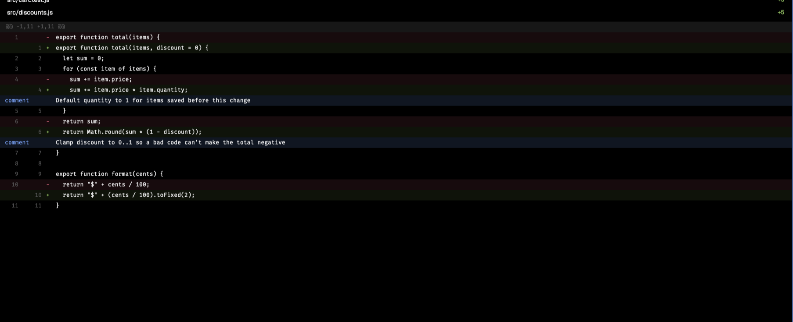

# herdr-branch-review

Review a branch in the [Herdr](https://herdr.dev) desktop app, laid out like lazygit. Comment on a line, a range of lines or a whole file, then send every comment to a coding agent as one review. Work through the pull request's GitHub review threads in the same place.



## Install

```sh
git clone https://github.com/cunderw/herdr-branch-review
./herdr-branch-review/install.sh
```

Then add the key to `~/.config/herdr-app/keys.json`, in the `global` and `terminal` sections (see `keys.json`):

```json
"ctrl-b shift-v": "mod.open:branch-review-open"
```

`install.sh` copies the mods into `~/.config/herdr-app/mods`, because a symlinked mod folder doesn't draw its icons.

## Update

```sh
cd herdr-branch-review && git pull && ./install.sh
```

## Use

`ctrl-b shift-v` opens a review tab for the focused pane's repo. Panels `[1]` Scope, `[2]` Files, `[3]` Commits and `[4]` GitHub sit on the left, and `[0]` the diff on the right. Drag the lines between panels to resize them. Press `?` for the keys of the focused panel. [RECIPE.md](RECIPE.md) describes all of it.

## Tests

```sh
node --import ./tests/harness/register.mjs --test tests/*.test.mjs
```
