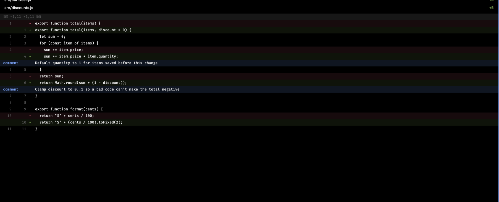

# Branch Review

A pane that shows a branch's changes: the whole branch against its base, the last commit, picked commits, or uncommitted work. Comment on a line, a range of lines or a whole file, then send every comment to an agent as one review through a dialog that shows exactly what is sent. A GitHub view reads the branch's pull request review threads: send one to the agent, queue it with the review, or reply on GitHub. Everything works from the keyboard with vim keys.

## What you see

The layout follows lazygit: boxed panels down the left, the main panel on the right, and a one-line key bar at the bottom. All in the theme's colors, UI text at 12px.

- **Panels**: each one is a box with a 1px border and 5px corners, with its title set into the top edge on `background`: `[n]` and the name, plus a `dim` summary on the right of the edge. The focused panel's border and title are `accent`; the others are `dim` at 60% and `muted`. In each list, the picked row is `selected` with a 3px `accent` bar in the focused panel, and `raised` in the others. Rows are 22px.
- **Left column**, a third of the pane wide (240–440px), top to bottom:
  - **[1] Scope**: `repo · feat/cart → main` with a branch icon in `muted`, then "Branch vs main" (the base's name), "Last commit" (its short hash in `dim`) and "Uncommitted", with their keys (`b`, `u`) in 10px `dim`. Picked commits add a row "2 commits" with a × that goes back to the branch.
  - **[2] Files**, summary `3 · +40 −12`: a status letter (A and U `ansi2`, D `ansi1`, M `blocked`), the folder in `dim` then the name, a comment badge (comment icon and count on `accent` at 20%), "binary" when it is, and `+n` `−n` in `ansi2`/`ansi1`. Over 100 untracked files, a line says how many aren't listed.
  - **[3] Commits**, summary the count: the branch's commits, newest first: short hash in `ansi3` (`accent` when picked) in the code font, subject, and age. Picked commits are tinted `accent` at 15%.
  - **[4] GitHub #42**, only when the branch has a pull request (or `gh` reported a problem), summary "3 open · 1 new": 46px rows with `path:line` in `accent`, "outdated" (`blocked`), "resolved", "in review" (`ansi2`), a "new" pill, then the author and the first comment on one line, and the comment count and age on the right.
  - Files, Commits and GitHub share the height left under Scope, equally until a splitter between them is dragged.
- **Splitters**: a 6px strip between the side column and the main panel (col-resize cursor) and a 5px strip between side panels (row-resize cursor). Hovered, they tint `accent` at 20%; while dragged, a 2px `accent` line.
- **Error strip** across the top when git fails: `ansi1` text on an `ansi1` tint, with a × to dismiss.
- **[0] Main panel**: titled with the open file's path, its summary "new, untracked", "context 23" or "whole file", and the scope's name. It shows the diff and, while composing, the comment box. When the GitHub panel was the last side panel focused, it shows the picked thread instead.
- **Diff**, in the terminal's code font at 11px, 20px rows that scroll both ways: old and new line numbers in `dim`, a `+`/`−` mark, then the line **syntax highlighted** by `syntax.js` (keywords `ansi5`, strings `ansi2`, numbers `ansi3`, comments `dim`, types `ansi6`, calls `ansi4`). Added rows are tinted `ansi2` at 9%, removed rows `ansi1` at 9%, hunk headers sit on `raised` in `dim`.
  - **More rows** (24px, `raised` at 53%): "⋯ Show lines above / Show hidden lines / Show lines below (20 more · e, or E for the whole file)", before a hunk that starts past line 1, between hunks, and after the last hunk when the file goes on.
  - The rows a comment is on carry a 3px `accent` bar at 40% on the left; the rows picked for a new comment are tinted `accent` at 20% with bright line numbers; the cursor row is `selected` with a full `accent` bar.
  - **Comment cards** under the last line they cover, indented past the gutter: `surface`, 7px corners, a 1px border in `accent` at 33% (full while it's being edited or under the cursor), a 10.5px caption with a comment icon ("Comment · lines 22–23"), and the text in the UI font, wrapping, up to 12 lines.
  - **Whole-file cards** ("Whole file") and **outdated cards** sit at the top of the file. An outdated card is `blocked`: "Outdated · line 9 changed since · sent with the code you saw", then the text and a `dim` "was: …" line with the code it was written on.
  - **GitHub thread rows** (branch view only), 22px on `ansi4` at 8%, under the line the thread is on: GitHub icon, author, the first line of the first comment, "+2 replies", "resolved", and a "new" pill.
- **Comment box**, only while composing, at the foot of the main panel on `surface`: "New comment" or "Edit comment", the file and lines, a textarea that grows from 2 to 8 rows (`accent` border while typing), then **Add comment** / **Save** (`solid`), **Cancel**, and **Delete** in `ansi1` for an existing comment.
- **Thread** (main panel, from the GitHub panel): titled `#42 title`, summary "3 open · 1 resolved". A bar with `path:line` in `accent` and **Fix**, **Add to review** / **In review**, **Reply**, **Show in diff**, **Open**; then every comment rendered as markdown, selectable. Reply opens a textarea with "posts publicly as your gh account", **Post to GitHub** and **Cancel**.
- **Key bar**, 30px, as lazygit's options bar: the focused panel's first keys, each key in `accent` and what it does in `dim`, then `s send` and `? keys`. While picking lines or commits, or typing, it shows the keys for that instead. On the right: a `dim` note of comments from other views and queued GitHub threads, the recipient chip (status dot in the status's color, program name, `space / tab · status`) and **Send review · N** (send icon, `solid` when there is something to send).
- **Keys popup** (`?`): a box on `surface` with an `accent` border over the dimmed pane, listing the focused panel's keys and the ones that work everywhere.
- **Send dialog** (this mod opened as a 760px dialog over the window): "Send review" or "Ask the agent", the title in `dim`, an Esc keycap; **To**: a select-looking box with the agent's status dot, name, `space / tab · status` and a chevron, opening a list of every agent with a check on the chosen one; a note textarea (2–5 rows; 3–8 for a question); the message, read-only in the code font, with **Copy**; warnings in `blocked` for outdated comments and for over 8 KB; an error line in `ansi1`; and a footer with a hint or the reason Send is off, **Cancel** and **Send**.

## How it behaves

- **Opening**: `ctrl-b shift-v` opens a new tab, "review: <branch>", with this mod as its only pane, for the focused pane's repo. It stays pinned to that repo. `q` closes the tab (in a split, only its pane).
- **Resizing**: drag the strip right of the side column to set its width (the main panel keeps at least 320px, the column 180px), or the strip between two side panels to move height from one to the other (each keeps 60px). Sizes are kept per repo.
- **Panels**: `1` `2` `3` `4` jump to Scope, Files, Commits and GitHub, `0` to the main panel. `h`/`l`, ←/→ and `tab`/`shift-tab` go to the previous or next panel, the main panel last. Clicking a panel focuses it. `j`/`k`, ctrl-d/ctrl-u, `gg`/`G` move in the focused one. Moving in Scope or Files shows that scope or file at once; Enter in Scope goes to Files, in Files to the main panel. Esc in the main panel goes back to the side panel it came from. The pane takes the keyboard when shown or clicked (`focusable`).
- **Scopes**: "Branch vs main" diffs the merge-base of `HEAD` and the base against `HEAD`; the base is `origin/HEAD`, else the first of `origin/main`, `main`, `origin/master`, `master`. "Last commit" diffs `HEAD~1` (the empty tree for a root commit) against the working tree, so it shows the last commit plus anything uncommitted. "Uncommitted" diffs `HEAD` against the working tree. Last commit and Uncommitted include untracked files, each shown as an all-added diff. `[`/`]` step through the three scopes from any panel; `b` and `u` pick the branch and uncommitted. Click a commit (or Enter on it) to see only it; again to go back; shift-click (or shift-Enter) another for the range, or `v`, `j`/`k`, Enter.
- **Refresh**: on any change under the repo (a folder watch, debounced 400ms, ignoring `.git/objects` and `.git/logs`), every 15 seconds, and on `r`. A remote repo has only the timer.
- **Commenting**: click a line to open the comment box on it; shift-click another line to stretch the comment over the lines between; click a hunk header to take the whole hunk. With the keyboard, `c` comments on the cursor line, `v` then `j`/`k` picks lines and `c` comments on them, `C` comments on the whole file (also `c` on a file in the Files panel). Enter saves, Shift-Enter is a new line, ⌘-Enter saves too, Esc cancels. Click a comment card (or `c` on it) to edit; Save with a new pick moves it. `x` deletes the comment under the cursor at once; `U` brings back the last one deleted.
- **Comments keep their code**: each comment saves its lines (kind, text, numbers) and two lines on each side. When the diff changes, it moves to where those exact lines are now, if they appear once (the lines around it break ties). If they can't be found, it's outdated: shown at the top in `blocked`, still sent, with the code you saw and a note that it changed. An open comment box follows its lines the same way, or says "those lines changed: click a line to pick again".
- **Views**: a comment belongs to the view it was made in (line numbers in a commit's diff differ from the branch's). Comments made in other views are counted in the key bar and sent too.
- **Context**: `e` or a "more" row shows 20 more unchanged lines around every change in the file; `E` or **Whole file** shows all of it (again to go back).
- **Ask**: right-click a line to ask about it, a hunk header to ask about the hunk, or a picked range to ask about that range; `a` does the same from the keyboard, and asks about the file's whole diff from the Files panel. It opens the dialog with the lines quoted; nothing is saved or cleared.
- **Send**: `s` or **Send review** first checks every commented file of this view against its current diff (moving or outdating comments), then opens the dialog with the message: one block per comment sorted by file and line, `### path, lines a–b`, the quoted lines with numbers and signs, and `Comment: …`; whole-file comments first in their file; queued GitHub threads with their replies.
- **The dialog**: picks the recipient (the one chosen with `t` in the pane, else agents in this repo, then this space, then the newest) and lists every agent; ctrl-n/ctrl-p or ctrl-j/ctrl-k change it. Send types the note and message into the agent with `hc send`:
  - an **idle** or **working** agent gets `hc send --if <that status>`, so herdr-core refuses if it changed in between; the dialog then says what it changed to, and nothing is sent;
  - a **done** agent gets a plain send (`--if` knows only idle and working);
  - a **blocked** agent isn't sent to: Send is off and the footer says to answer its prompt first.
  - Nothing retries by itself. Send is off while one is in flight. On success the dialog closes, toasts "Sent to …", focuses the agent's pane, and sets shared `branch-review.sent` to the send's id; the pane then removes exactly the comments it sent.
- **GitHub**: on opening, `gh pr view` finds the branch's pull request (on GitHub Enterprise too: the host comes from the PR's URL and goes to `gh api --hostname`). Threads are read with GraphQL, 50 a page, up to 10 pages, every 5 minutes and on `r`. `4` (or `p`, which toggles back to Files) focuses the GitHub panel. There and in the thread it shows: `j`/`k` move (marking a thread seen), Enter shows it in the branch diff, `f` sends it to the agent, `i` queues it with the review (again to unqueue), `R` opens a reply, `o` opens the thread and `O` the pull request in the browser, `H` shows resolved threads. ⌘-Enter or **Post to GitHub** posts a reply as the person's `gh` account; on any failure the draft stays and the error says it may still have posted, so check before posting again. A repo with no remote or no PR shows no GitHub tab; a missing or signed-out `gh` shows how to fix it in the GitHub view.
- **Agent statuses** shown on the recipient chip and in the dialog: working, blocked, done and idle each as a dot in the theme's color of that name.

## Built from

- `mods/branch-review/`, `mod.json` `{ "place": "none", "focusable": true }`:
  - `main.js`: the pane. When `props().dialog` is set it hands the copy to `Dialog` before anything runs git.
  - `review.js`: diff rows (`diffRows` with "more" rows), comment model (`rangeComment`, `fileComment`, `migrate` from the old one-line `{path, side, line, code}`), placement (`locate`, `placeAll`, `refreshed`), refs per scope (`diffRefs`), and the messages (`reviewMessage`, `questionContext`, `threadText`). No herdr imports.
  - `syntax.js`: a line tokenizer by file extension (comments, strings, numbers, keywords, types, calls), each side of a diff keeping its own block-comment state.
  - `dialog.js`: the send dialog; `rankAgents`.
  - `github.js`: `findPr`, `fetchThreads`, `replyToThread`, `visibleThreads`, taking a `gh(args)` function. No herdr imports.
  - Lucide icons: `check`, `chevron-down`, `chevron-right`, `comment`, `copy`, `expand`, `git-branch`, `github`, `send`, `x`.
- `mods/branch-review-open/`: a 1×1 popup that runs `tab.new {name, space, mod: "branch-review", props: {folder, on, space}}` and closes, because a key can't pass props.
- `keys.json`: `ctrl-b shift-v` → `mod.open:branch-review-open` in `global` and `terminal`. Mod commands (bind them in `keys.json` if wanted): `branch-review.send`, `.ask`, `.refresh`, `.github`, `.close`.
- Programs: `git` (`rev-parse`, `branch`, `symbolic-ref`, `merge-base`, `log`, `diff`, `diff --no-index`, `ls-files`, `show`) with `--no-optional-locks -c core.fsmonitor=false -c diff.autoRefreshIndex=false`, so it never writes under `.git`; `gh` (`pr view`, `api graphql`); `hc send`; `open` for URLs.
- herdr: `exec`, `readTextFile`, `watchFolder`, `agents`, `terminals`, `spaces`, `panes`, `focused`, `openOverlay`, `closeOverlay`, `shared`, `setShared`, `notify`, `run` (`tab.new`, `tab.close`, `pane.close`), `nextCommand`, `theme`, `settings`, `props`. gpui-base: `v_virtual_list` with per-item sizes, `TextareaState`/`Textarea`, `Popover`, `TextView.markdown`, `Scrollbar`.
- `tests/`: `node --import ./tests/harness/register.mjs --test tests/*.test.mjs`. `review.test.mjs` and `github.test.mjs` test the pure modules; `flow.test.mjs` drives the pane with keys against a real git repo, with gpui and herdr stubbed in `tests/harness` (the stub rejects non-numeric sizes, bad colors and mismatched virtual list sizes, as the app does).

## Watch out

- A virtual list's rows can't have `on_click`: use `on_item_click((key, cx) => …)` and `on_item_secondary_click`. Clicks arrive without modifiers, so shift is read from the root's `on_mouse_down`.
- Comment cards need their height up front: it's estimated from the text (6.6px a character at 12px, 16px lines), so a comment with very long words can lose its last line. Cards cap at 12 lines.
- `line_height(16)` is a 16× multiplier; write `"16px"`. `flex_shrink` takes a number. A color must be hex or a theme color, never `transparent`.
- A theme color can already carry an alpha (`background` is `#rrggbbaa` when `window_opacity` is below 1), so adding two more hex digits makes an invalid color: `tint()` replaces the alpha instead. For the same reason, the panel title isn't painted over its border: the top edge is drawn in pieces around it.
- `localStorage` is per mod copy, so the dialog can't read the pane's comments: the pane passes the finished message in props and learns of delivery through the shared key.
- The textarea is re-focused 40ms after opening a comment box, only if the box is still open: an unguarded re-focus steals the keyboard after a quick save.
- Icons and other assets don't load when the mod folder is a symlink into another directory; copy the folder into `mods/` instead.
- `hc send` waits for a pause in the person's typing in the target terminal, then pastes and presses Enter.
- Limits: 3,000 diff lines a file, 2,000 characters a line, 100 untracked files, 50×10 GitHub threads with 50 comments each.

## Done when

- `herdr-app check mods/branch-review` and `herdr-app check mods/branch-review-open` pass, and the tests pass.
- `ctrl-b shift-v` on a branch opens a tab with the Scope, Files and Commits panels on the left and the first file's diff on the right, syntax highlighted, with line numbers.
- `1`–`4`, `0`, `h`/`l` and `tab` move the `accent` border between panels; `?` lists the focused panel's keys.
- `]` from the branch shows the last commit plus uncommitted work, including an untracked file as all added lines.
- Clicking a line, shift-clicking another and typing two lines with Shift-Enter, then Enter, adds a card under the last line reading "Comment · lines a–b"; `v` `j` `j` `c` does the same from the keyboard.
- Adding lines above a commented line moves the card with its code; changing the commented line makes it outdated.
- `e` shows more lines; `E` shows the whole file.
- Right-click on a line opens "Ask the agent" with that line quoted; sending it leaves the comments alone.
- `s` opens "Send review" with every comment; Send types it into an idle agent with `--if idle`, closes, and the comments are gone; a blocked agent can't be sent to.
- On a branch with a pull request, the GitHub panel lists its threads and the main panel shows the picked one; `f` sends one to the agent, `i` adds it to the review, `R` and ⌘-Enter post a reply.
